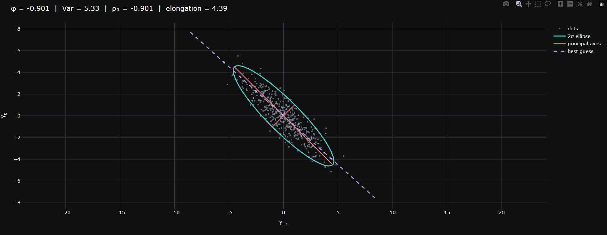
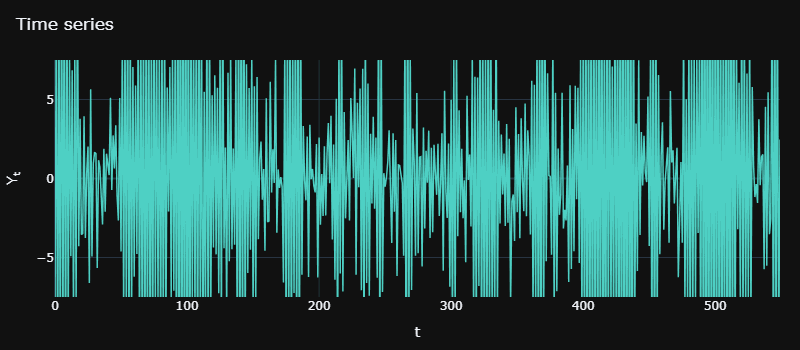
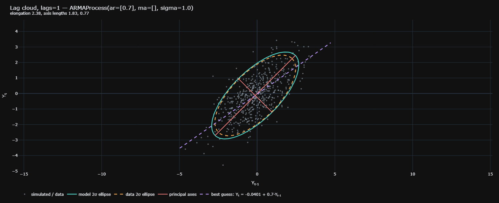
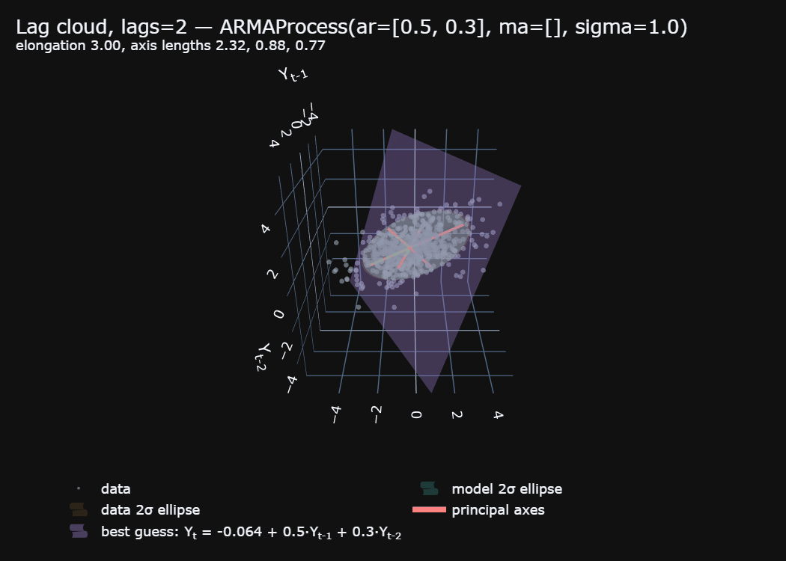
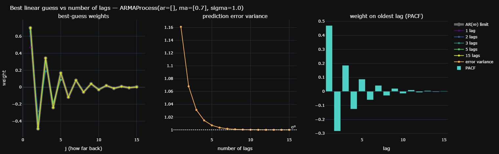
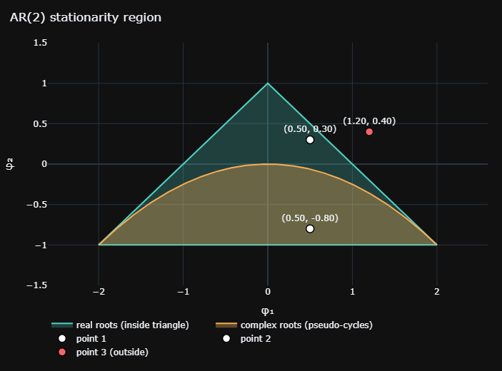
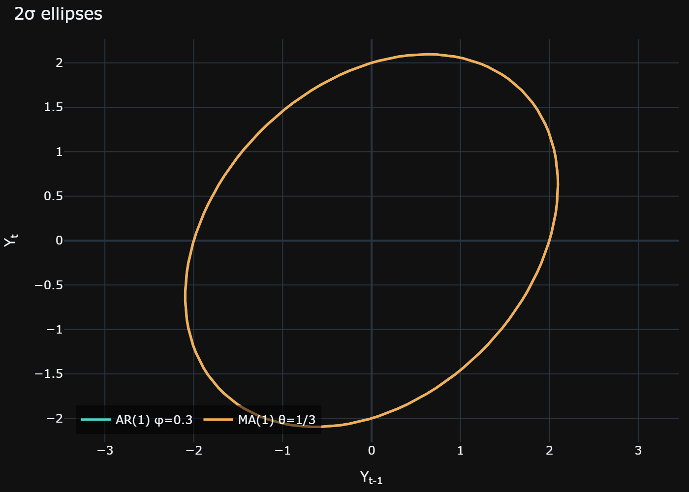
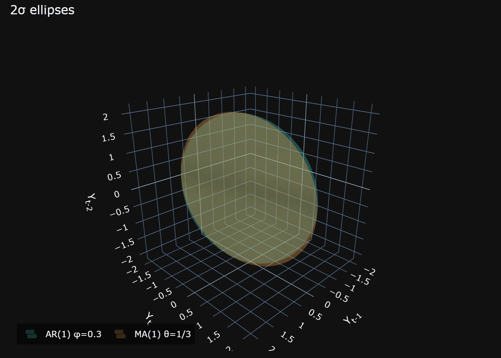

# lagshape

**See what an AR, MA or ARMA process "looks" like — and test whether your model, that supposedly fits the data, actually fits.**




*Slide the AR coefficient φ and watch the cloud of dots, its covariance ellipse, its principal axes and the best-guess line move. This is `plot_sweep`, in one line of Python.* A very thin needle-like ellipse in positive direction implies high similarity in consecutive values of the time series whereas needle-like ellipse in the negative direction implies high dissimilarity (notice the series becomes very noisy).

---

## The idea in one minute

Take any time series and plot each value against the one before it: a dot at (Yₜ₋₁, Yₜ). For a linear process such as an AR(1), the dots form a tilted oval. The tilt, the stretch and the thickness of that oval are not decoration: they are the process.

- The **long axis** points along the diagonal because values stay close to their neighbours. As φ → 1 the oval becomes a needle and the variance explodes.
- The **best linear guess** of today from yesterday is a line through the cloud. Its slope is φ.
- Add a second lag and the oval becomes an **ellipsoid**, and the guess becomes a **plane**.

`lagshape` turns that picture into objects you can compute with: the ellipse's axes, its volume, how stretched it is, the prediction plane, and how all of it changes with the parameters. It works for any ARMA(p, q), and for real data as well as theory, with the *same interface for both*. That makes "does my data look like this model?" a direct comparison of two shapes.

---

## What already existed, and what lagshape adds

`lagshape` stands on well-tested libraries. It adds a few new visual tools and forms a wrapper to the existing ArmaProcess in statsmodels.tsa lib. Here is exactly who does what.

| Piece | Already available (reused) | **Added by lagshape** |
|---|---|---|
| ARMA maths | statsmodels `ArmaProcess`: roots, autocovariances, simulation | One `ARMAProcess` object with the sign convention of the textbooks (`ar=[φ]`, `ma=[θ]`, `sigma`), a **distance-to-unit-root `margin`** (so "almost non-stationary" is a number, not a yes/no), a complex-roots flag, the spectral density, seeded simulation with **pluggable noise** (Student-t, skewed, ARCH-like …) |
| The shape of the process | SciPy `toeplitz`, `eigh` | **`LagCloud`**: the cloud of (Yₜ, Yₜ₋₁, …, Yₜ₋ₖ) as an object — covariance, principal axes, elongation, volume, boundary points — for **any number of lags**, built from a model *or* from data with the same methods |
| Best linear guess | statsmodels `levinson_durbin`, OLS | The guess as **geometry**: the hyperplane through the cloud (`predictor()`), plus **`predictor_convergence`** and **`ar_inf_weights`**, which show the guess weights of an MA converging to its AR(∞) form as more lags are allowed |
| Parameter space | — | **Region maps**: AR(2) stationarity triangle, MA(2) invertibility triangle, and the curve separating real from complex roots (pseudo-cycles) |
| Theory vs data | — | **`compare_clouds`, `compare_lags`** (cloud match at lags 1…k) and **`cloud_test`**, a simulation test (with parametric-bootstrap refitting) that tells you whether a mismatch is bigger than chance |
| Fitting and diagnostics | statsmodels `ARIMA`, `adfuller`, Ljung-Box | Thin wrappers that return lagshape objects: `fit_arma` gives an `ARMAProcess`; `diagnose` prints a plain-language report; `select_order` ranks all (p, q) |
| Pictures | plotly | **Interactive views built for this geometry**: the φ/θ **slider** (`plot_sweep`), 2D/3D clouds with ellipse and best-guess plane, regions map, convergence plot, ellipse overlays |


---

## Install

```bash
pip install git+https://github.com/kalaapks/lagshape.git
pip install yfinance          # optional: only for downloading prices, will be needed when data.py layer is added
```

Or from a local copy:

```bash
git clone https://github.com/kalaapks/lagshape.git
cd lagshape
pip install -e .
```

Python 3.10 or newer. Core dependencies: NumPy, SciPy, statsmodels (which brings pandas), and Plotly.

```python
import lagshape as ls     # everything is available as ls.<name>; type "ls." and press Tab
```

---

## Quick start

```python
import lagshape as ls

p = ls.ARMAProcess(ar=[0.7])             # Y_t = 0.7 Y_{t-1} + noise
p.is_stationary, p.margin, p.variance    # (True, 0.4286, 1.961)
p.acf(3)                                 # [1.    0.7   0.49  0.343]

y = p.simulate(1000, seed=42)            # 1000 simulated observations

ls.plot_cloud(p, seed=1).show()          # dots + ellipse + axes + best-guess line
```



---

## A tour

### 1. A process: `ARMAProcess`

```python
p = ls.ARMAProcess(ar=[0.5, 0.3], ma=[0.4], sigma=1.5)

p.is_stationary, p.is_invertible     # root conditions
p.margin                             # distance of the nearest root from the unit circle (0 = on the edge)
p.ar_roots, p.has_complex_roots      # complex roots mean pseudo-cycles
p.variance, p.autocov(5), p.acf(5), p.pacf(5)
p.spectral_density(np.linspace(0, np.pi, 100))
y = p.simulate(2000, seed=1)
```

Different noise, same process:

```python
t5 = lambda rng, size: rng.standard_t(5, size) / (5/3) ** 0.5     # fat tails, variance 1
y = p.simulate(2000, seed=1, innovations=t5)
```

### 2. The cloud: `LagCloud`

```python
c = ls.LagCloud.from_process(ls.ARMAProcess(ar=[0.7]), lags=1)
c.cov                   # [[1.961 1.373] [1.373 1.961]]
c.axis_lengths          # [1.83 0.77]   semi-axes of the 1σ ellipse
c.axes                  # their directions (the diagonals)
c.elongation            # 2.38  (long axis / short axis)
c.volume()              # area at 1σ (a volume if lags > 1)

d = ls.LagCloud.from_data(y, lags=1)          # same object, measured from data
ls.compare_clouds(d, c)                       # covariance error, axis ratios, volume ratio
```

Same code, any number of lags. With `lags=2` the cloud is a 3D ellipsoid, and for *every* ARMA process one of its principal axes is exactly the direction (1, 0, −1): a consequence of the covariance matrix being symmetric Toeplitz, verified in the test suite.



### 3. The best guess, and what happens to the cloud as you allow more lags

```python
pr = c.predictor()
pr.weights, pr.error_variance, pr.r_squared   # [0.7]  1.0  0.49
pr.predict(y)                                 # guesses for y[1:]
```

For an MA(1), one lag gives a weak guess; more lags approach the AR(∞) form of the process:

```python
m = ls.ARMAProcess(ma=[0.7])
ls.ar_inf_weights(m, 3)                       # [ 0.7  -0.49  0.343]   the limit
conv = ls.predictor_convergence(m, 6)
conv.weights[0]                               # [0.47]                 1 lag
conv.weights[2]                               # [ 0.655 -0.395  0.186] 3 lags
conv.error_variance                           # 1.161, 1.068, 1.031 ... -> sigma^2 = 1
conv.last_weight                              # the PACF
```

```python
ls.plot_convergence(m, 15).show()
```



### 4. The map of parameters

```python
ls.ar2_stationary(0.5, 0.3)        # True
ls.ar2_stationary(1.2, 0.4)        # False
ls.ar2_complex_roots(0.5, -0.8)    # True: this AR(2) has pseudo-cycles

ls.plot_regions("ar2", points=[ls.ARMAProcess(ar=[0.5, 0.3]), (0.5, -0.8), (1.2, 0.4)]).show()
```

<p align="center">
  
</p>

### 5. Different models, same cloud

At one lag, an AR(1) with φ = 0.3 and an MA(1) with θ = 1/3 (σ ≈ 0.9945) have identical clouds. At two lags they separate. A matching cloud is evidence about second-order structure up to that many lags, not proof of the model.

```python
a = ls.LagCloud.from_process(ls.ARMAProcess(ar=[0.3]), 1)
b = ls.LagCloud.from_process(ls.ARMAProcess(ma=[1/3], sigma=0.9945), 1)
ls.plot_ellipses({"AR(1) φ=0.3": a, "MA(1) θ=1/3": b}).show()    
# the ellipses coincide but the same process for lags=2 do not look same anymore
```

<p align="center">
  
  
</p>

---

## From data (under construction)

The final layer of this library. This will take in real-data, find the correct ARMAProcess(p, q) to fit and then compare the data-cloud and the model-cloud. If the model fits the data well, the clouds will match more. A perfect fit will give exact same clouds.

---

## Conventions

- Model: **Yₜ = Σ φᵢ Yₜ₋ᵢ + εₜ + Σ θⱼ εₜ₋ⱼ**, εₜ with standard deviation `sigma`. `ar=[φ₁, …]`, `ma=[θ₁, …]`. (statsmodels' polynomial form `[1, −φ₁, …]` is converted internally.)
- A **cloud** has coordinates (Yₜ, Yₜ₋₁, …, Yₜ₋ₖ) in the library; **plots** use (x, y, z) = (Yₜ₋₁, Yₜ, Yₜ₋₂).
- Roots must lie **outside** the unit circle: `margin` = min |root| − 1.
- Axis directions are defined only up to sign.

## Good to know

- Theory objects (`ARMAProcess`, theoretical `LagCloud`) are zero-mean; data clouds subtract the mean. `fit_arma` (soon to come, it will fit the correct ARMAProcess to data) keeps the fitted level in `fit.mean`.
- A cloud sees only **second-order** structure (variances and correlations). Fat tails and volatility clustering are invisible to it — that is what `diagnose` and the squared-series test are for.
- Forecasts are **one step ahead**. ARMA only: no differencing (use returns), no seasonality, no GARCH modelling.
- With real data, an *exact* match never happens; `cloud_test` is how you decide what "close enough" means.
- A perfect match of clouds at all lags identifies an invertible, causal, minimal ARMA uniquely. At finitely many lags it does not (see section 5 above).

---

## Everything in `lagshape`

| Group | Names |
|---|---|
| Process | `ARMAProcess` (`.is_stationary` `.is_invertible` `.margin` `.ar_margin` `.ma_margin` `.ar_roots` `.ma_roots` `.has_complex_roots` `.variance` `.autocov()` `.acf()` `.pacf()` `.spectral_density()` `.simulate()`) |
| Geometry | `LagCloud`, `LinearPredictor`, `lag_matrix`, `predictor_convergence`, `ar_inf_weights`, `compare_clouds` |
| Regions | `ar2_stationary`, `ma2_invertible`, `ar2_complex_roots`, `ar2_triangle`, `ma2_triangle`, `ar2_complex_boundary` |
| Plots | `plot_cloud`, `plot_series`, `plot_acf`, `plot_sweep`, `plot_regions`, `plot_convergence`, `plot_ellipses` |

In Python: `help(ls.LagCloud)`, `ls.ARMAProcess.margin?` (IPython), or `python -m pydoc lagshape.geometry`.

## Project layout

```
src/lagshape/
  process.py     ARMAProcess: the exact numbers of a model
  geometry.py    LagCloud, predictor, convergence, regions, compare_clouds
  plots.py       plotly figures
```

## Acknowledgements

Built on [statsmodels](https://www.statsmodels.org), [SciPy](https://scipy.org), [NumPy](https://numpy.org), [pandas](https://pandas.pydata.org) and [plotly](https://plotly.com/python/). The base model for this python library inspired the interactive HTML explainers: 
[AR(1)](https://kalaapks.github.io/time-series/interactive-models/ar1.html) | [AR(2)](https://kalaapks.github.io/time-series/interactive-models/ar2.html) | [MA(1)](https://kalaapks.github.io/time-series/interactive-models/ma1.html) | [MA(2)](https://kalaapks.github.io/time-series/interactive-models/ma2.html)

## License

MIT
