# lagshape

> **See what an AR, MA, or ARMA process "looks" like—test whether a model that supposedly fits your data actually does, and spot where linear ARMA breaks down (such as volatility clustering).**

[](LICENSE)
[](pyproject.toml)

---

<p align="center">
  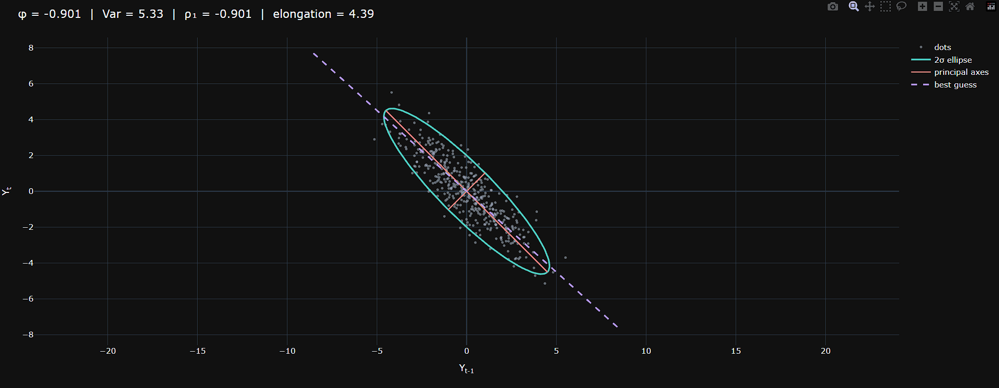
</p>
<p align="center">
  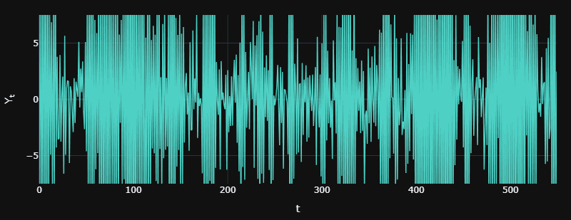
</p>

<p align="center">
  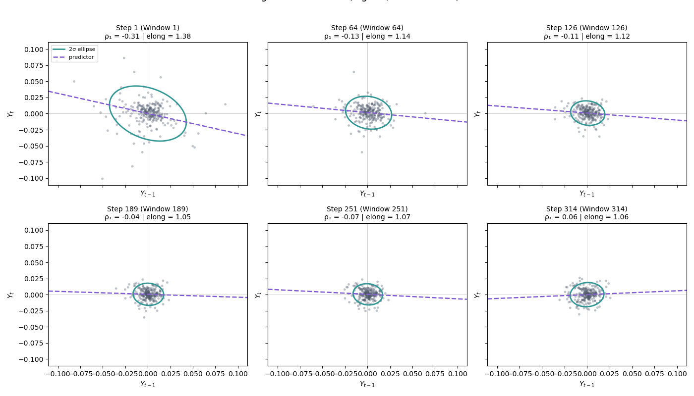<span style="display:inline-block; width:2%;"></span>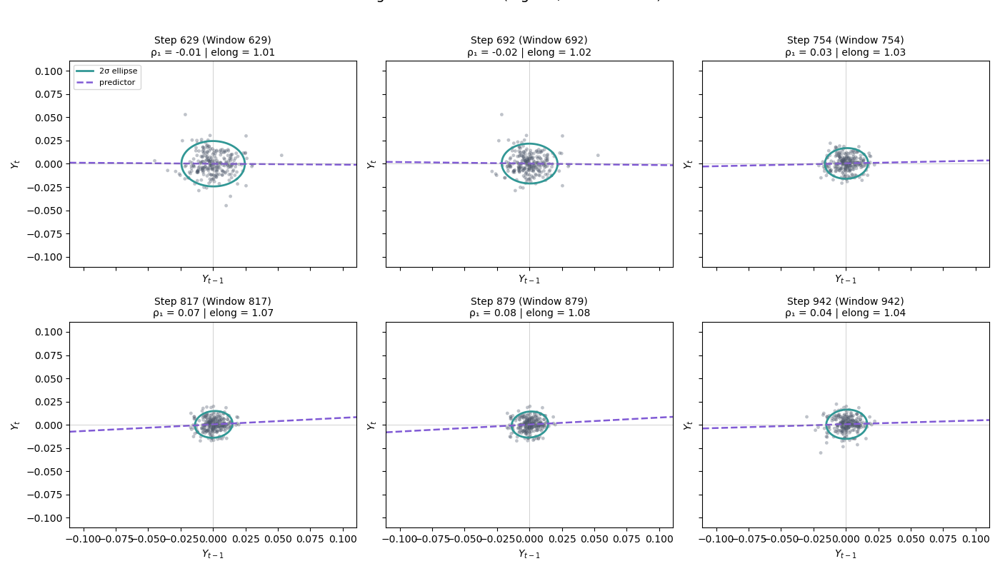<br>
  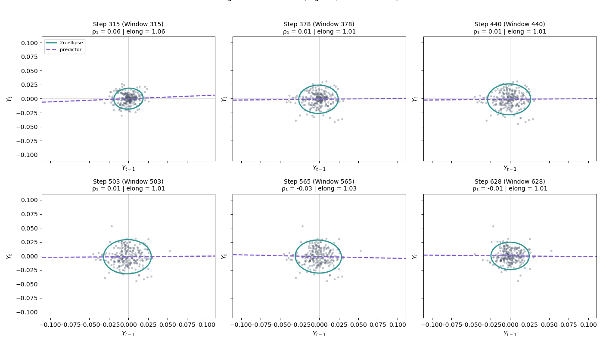<span style="display:inline-block; width:2%;"></span>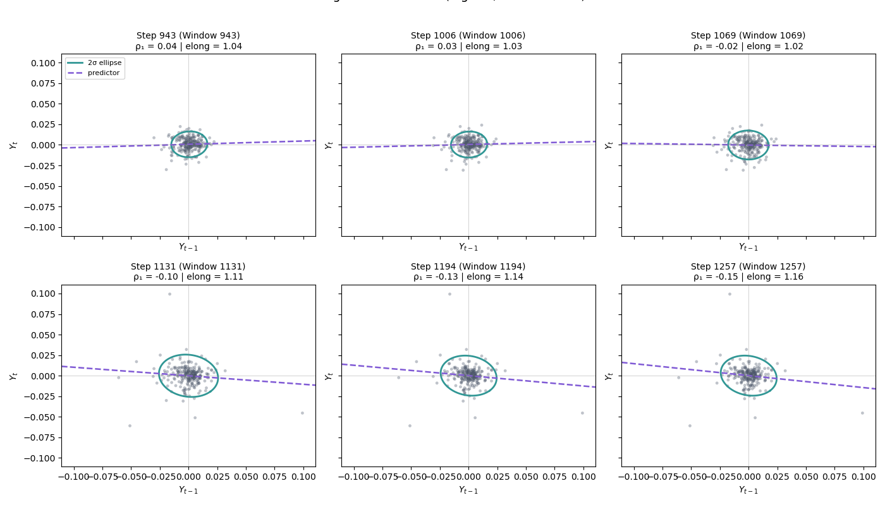<br>
  <em><strong><code>rolling_cloud</code></strong> runs this to show how the volatility changes over time</em>
</p>

---

## The idea in one minute

Plot each value of a time series against the previous one: a dot at $(Y_{t-1}, Y_t)$. For a stationary linear process like an AR(1), those dots form a tilted oval whose shape encodes the dynamics:

- **Stretch and tilt:** Positive correlation stretches the cloud along the diagonal; as $\phi \to 1$, it narrows toward a needle and variance grows.
- **Best linear guess:** The conditional expectation of today given yesterday is a **line** through the cloud (with slope $\phi$).
- **More lags:** Adding a second lag turns the oval into a 3D **ellipsoid** and the line into a **plane**.

`lagshape` turns this geometry into computable objects (`LagCloud` and `LinearPredictor`) using the **same interface for theoretical models and empirical data**. Testing a model becomes a direct comparison of two shapes—and checking where real market data departs from them.

---

## What already existed, and what `lagshape` adds

Built on `statsmodels`, `SciPy`, `NumPy`, `pandas`, and `Plotly`:

| Area | Reused from ecosystem | **Added by `lagshape`** |
|---|---|---|
| **Process & simulation** | `statsmodels.tsa.arima_process` | Textbook sign convention (`ar=[φ]`, `ma=[θ]`, `sigma`), stability `margin`, spectral density, and custom/heavy-tailed noise simulation |
| **Phase-space geometry** | `scipy.linalg.toeplitz`, `eigh` | `LagCloud` for any lag count: axes, elongation, volume, boundary points, and `predictor()` hyperplane |
| **Lag & parameter geometry** | `levinson_durbin`, `ARMA.arma2ar` | `predictor_convergence`, `ar_inf_weights`, AR(2)/MA(2) stability/cycle regions, and `compare_clouds` |
| **Data & fit verification** | `ARIMA`, `adfuller`, `acorr_ljungbox` | `diagnose` (including squared-return volatility clustering), `select_order`, `fit_arma` |
| **Forecasting & drift** | — | Out-of-sample `walk_forward` with Clark–West test, and `rolling_cloud` to track regime/volatility shifts over time |
| **Theory vs data** | — | **`compare_clouds`, `compare_lags`** (cloud match at lags 1…k) and **`cloud_test`**, a simulation test (with parametric-bootstrap refitting) that tells you whether a mismatch is bigger than chance |
| **Visuals & practice data** | — | `plot_sweep`, `plot_cloud`, `plot_ellipses`, `plot_regions`, `plot_convergence`, and offline `example_series` |

---

## Install

```bash
pip install git+https://github.com/kalaapks/lagshape.git
pip install yfinance  # optional: needed for load_prices()
```

Or from a local clone (Python 3.10+):

```bash
git clone https://github.com/kalaapks/lagshape.git
cd lagshape
pip install -e .
```
```python
import lagshape as ls
import lagshape.data as lsd
import lagshape.plots as lsp
```
You can also just use `import lagshape as ls` and then  `ls.`+"Tab" to see layered available methods and functions in Jupyter lab.

---

## A tour

### 1. A process: `ARMAProcess`

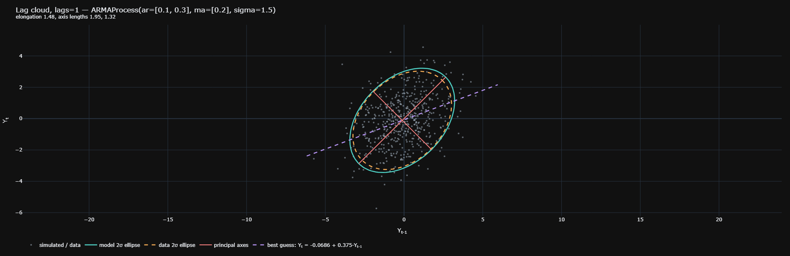

```python
p = ls.ARMAProcess(ar=[0.1, 0.3], ma=[0.2], sigma=1.5)

p.is_stationary, p.is_invertible   # root conditions
p.margin                           # distance of the nearest root from the unit circle (0 = on the edge)
p.ar_roots, p.has_complex_roots    # complex roots mean pseudo-cycles
p.acf(3)                           #[1.     , 0.375  , 0.3375 , 0.14625]
p.autocov(5), p.acf(5), p.pacf(5)
p.variance, p.spectral_density(np.linspace(0, np.pi, 100))
y = p.simulate(2000, seed=1)
```

Different noise, same process (default is White-noise):

```python
t5 = lambda rng, size: rng.standard_t(5, size) / (5/3) ** 0.5     # fat tails, variance 1
y = p.simulate(2000, seed=1, innovations=t5)
```

### 2. The cloud: `LagCloud`

```python
c = ls.LagCloud.from_process(ls.ARMAProcess(ar=[0.7]), lags=1)
c.cov                   # [[1.961 1.373] [1.373 1.961]]
c.axis_lengths          # [1.83 0.77]   semi-axes of the 1σ ellipse
c.axes                  # their directions (the diagonals)
c.elongation            # 2.38  (long axis / short axis)
c.volume()              # area at 1σ (a volume if lags > 1)

d = ls.LagCloud.from_data(y, lags=1)          # same object, measured from data
ls.compare_clouds(d, c)                       # covariance error, axis ratios, volume ratio
```

Same code, any number of lags. With `lags=2` the cloud is a 3D ellipsoid, and for *every* ARMA process one of its principal axes is exactly the direction (1, 0, −1): a consequence of the covariance matrix being symmetric Toeplitz, verified in the test suite.

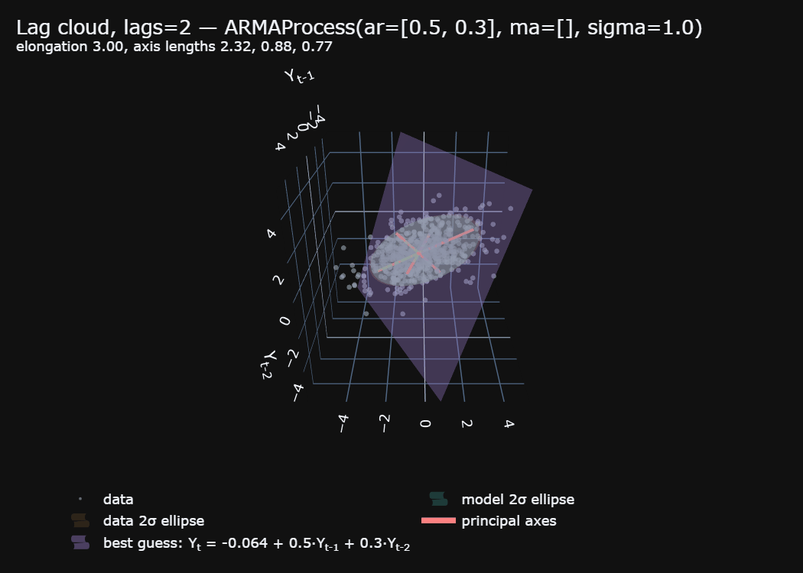

### 3. The best guess, and what happens to the cloud as you allow more lags

```python
pr = c.predictor()
pr.weights, pr.error_variance, pr.r_squared   # [0.7]  1.0  0.49
pr.predict(y)                                 # guesses for y[1:]
```

For an MA(1), one lag gives a weak guess; more lags approach the AR(∞) form of the process:

```python
m = ls.ARMAProcess(ma=[0.7])
ls.ar_inf_weights(m, 3)                       # [ 0.7  -0.49  0.343]   the limit
conv = ls.predictor_convergence(m, 6)
conv.weights[0]                               # [0.47]                 1 lag
conv.weights[2]                               # [ 0.655 -0.395  0.186] 3 lags
conv.error_variance                           # 1.161, 1.068, 1.031 ... -> sigma^2 = 1
conv.last_weight                              # the PACF
```

```python
ls.plot_convergence(m, 15).show()
```

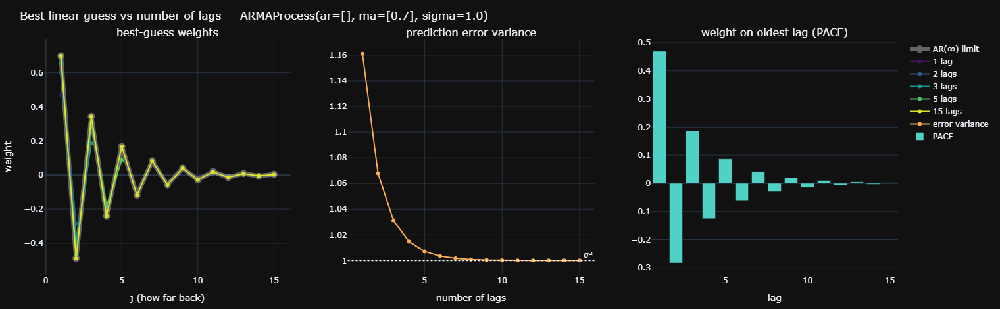

### 4. The map of parameters

```python
ls.plot_regions("ar2", points=[ls.ARMAProcess(ar=[0.5, 0.3]), (0.5, -0.8), (1.2, 0.4)]).show()
ls.plot_regions("ma2", points=[ls.ARMAProcess(ma=[0.5, 0.3]), (0.5, -0.8), (1.2, 0.4)]).show()
```

<p align="center">
  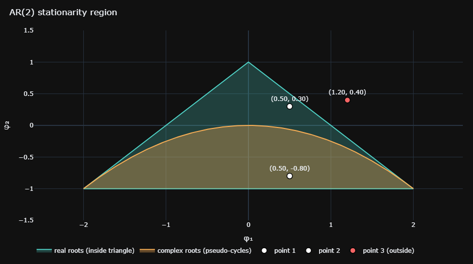
  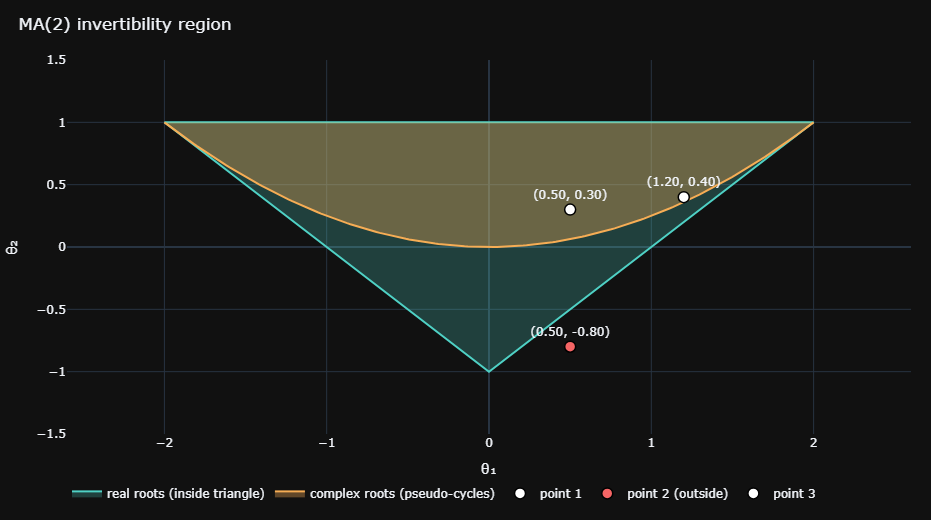
</p>


### 5. Different models, same cloud

At one lag, an AR(1) with φ = 0.3 and an MA(1) with θ = 1/3 (σ ≈ 0.9945) have identical clouds. At two lags they separate. A matching cloud is evidence about second-order structure up to that many lags, not proof of the model.

```python
a = ls.LagCloud.from_process(ls.ARMAProcess(ar=[0.3]), 1)
b = ls.LagCloud.from_process(ls.ARMAProcess(ma=[1/3], sigma=0.9945), 1)
ls.plot_ellipses({"AR(1) φ=0.3": a, "MA(1) θ=1/3": b}).show()    
# the ellipses coincide but the same process for lags=2 do not look same anymore
```

<p align="center">
  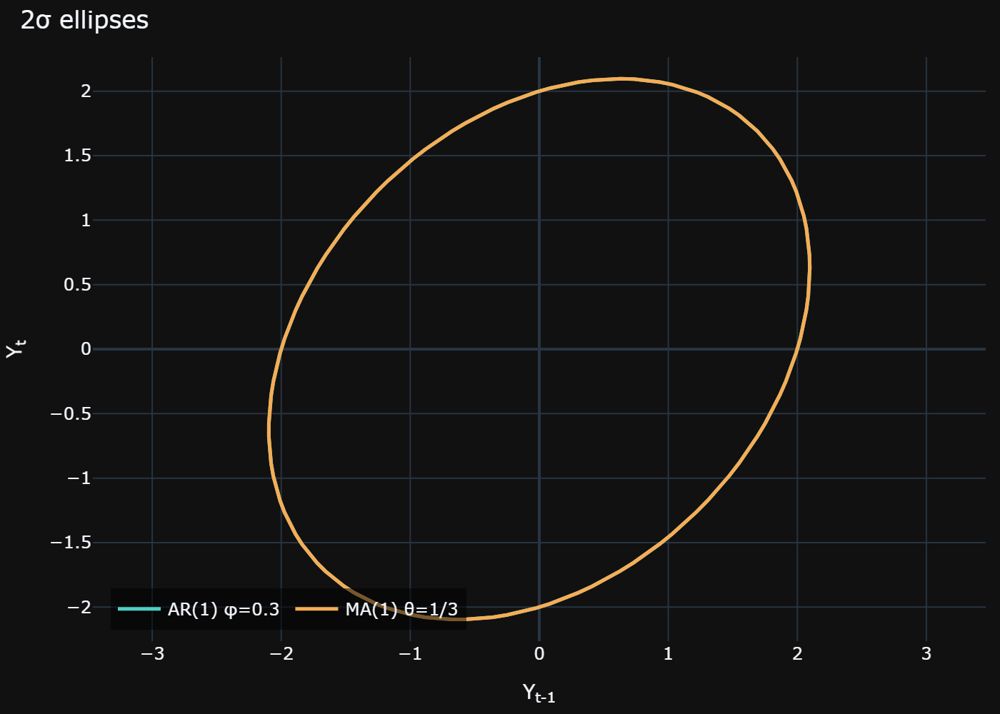
  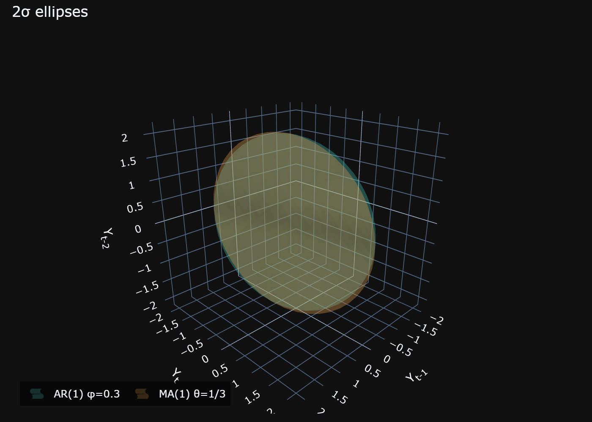
</p>

---

## From data

See [Demo.ipynb](Demo.ipynb) for detailed guide. We can download from `yfinance` or use `example_series("roll")` available in the library. Other options: `white`, `spread`, etc. 
```python
y = lsd.example_series("roll", 3000, seed=1)
print(lsd.diagnose(y))
```

```text
observations            3000
mean / std              -0.0008898 / 0.5202
skewness                0.045
excess kurtosis         -0.36    (0 = normal; much larger = fat tails)
ADF p-value             0.0000  -> looks stationary?             yes
Ljung-Box p (lag 20)   0.0000  -> autocorrelated?                yes
Ljung-Box p, squares    0.0920  -> volatility clustering?           no
```

```python
lsd.select_order(y, 2, 2, "bic").head(3)    # BIC picks (p, q) = (0, 1)
fit = lsd.fit_arma(y, (0, 1))
print(fit)                                     
fit.model        # just an ARMAProcess, ready for everything above
```

**Compare the data's cloud with the model's cloud, at several lags:** This comapres several geometric properties of the two clouds such as `cov_rel_error` $\Big(\frac{\|\Sigma_a - \Sigma_b\|_F} {\|\Sigma_b\|_F}\Big)$, `elongation` $(\sqrt{\lambda})$, etc that are discussed in details in [Demo.ipynb](Demo.ipynb).

```python
lsd.compare_lags(y, fit.model, (1, 2, 3, 5))
```

**Is any remaining mismatch more than chance?** `cloud_test` simulates many series from the model, re-fits each one, and asks how often the mismatch is as large as yours:

```python
print(lsd.cloud_test(y, fit, lags=1, n_sim=100, seed=0, refit=(0, 1)))
#p-value 0.426, not a good fit actually
```

(When the model was fitted on the same data, use `refit=`; otherwise the test flatters the model. It takes a little while: each simulation re-fits the model.)

**Draw the data against the model:**

```python
lsp.plot_cloud(y, model=fit.model).show()          # solid = model, dashed = data's own
```
<!-- 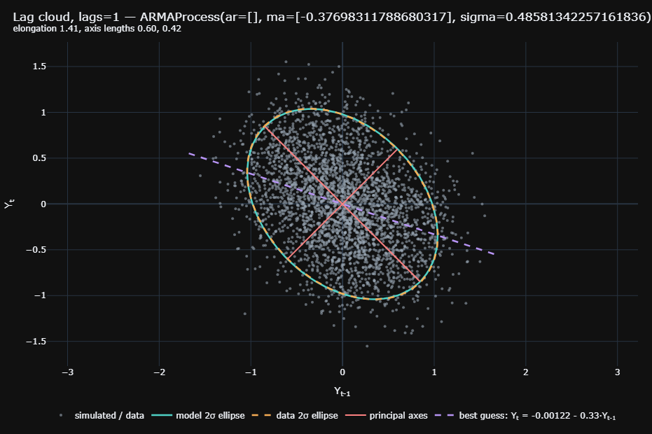 -->

<div align="center">
  
</div>
<p align="center">
  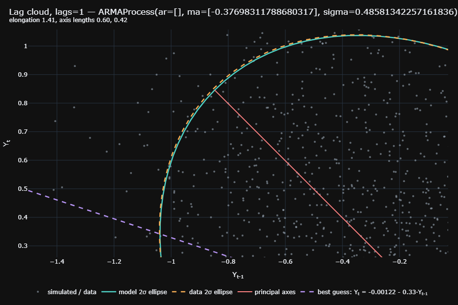
  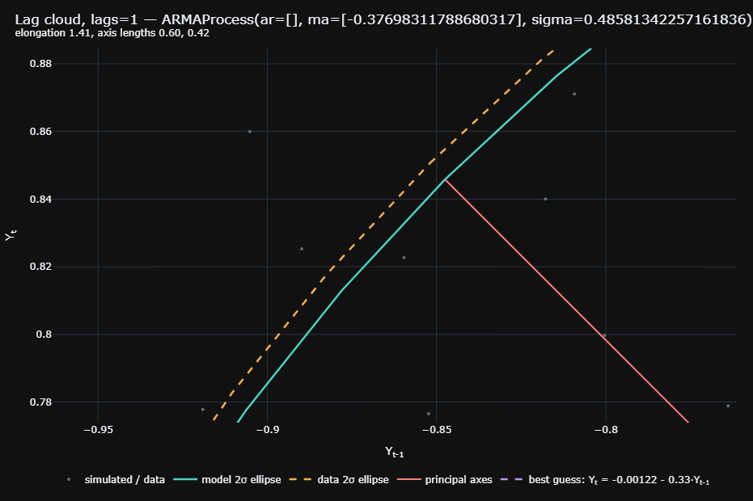
  <em>The fitted model starts diverging real fast from data's ellipse</em>  
</p>

**Can it predict data it hasn't seen?**

```python
print(ls.walk_forward(y, lags=2))  #see Demo.ipynb for other parameters to exploit
```
Checks if ordinary average process is better or worse than Regression method (of order `lags`) to do predictions. Clark-West p-value test checks if lags really brings in any predictive power. Output table has out-of-sample $R^2_{oss}$ test, RMSE model/ Usual averaing, etc.

Now the control: the `"arch"` series (GARCH returns, uncorrelated by construction):

```python
print(lsd.walk_forward(ls.example_series("arch", 3000, seed=1), lags=2))
# out-of-sample R^2 +0.0001, Clark-West p 0.31: nothing to predict, and the test says so
```

**Does the shape stay put over time?** Generally, no. We investigate that using `lsd.rolling_cloud(P, lags, window=250, step, plot=True, plot_steps=t)`


**Real prices:**

```python
prices  = ls.load_prices("SPY", start="2015-01-01")    # needs: pip install yfinance
returns = ls.to_returns(prices)                        # log returns
print(ls.diagnose(returns))                            # compare with the practice series above
```

A CSV works too: `ls.read_series("prices.csv", column="Close")`.

> Don't expect much from liquid daily returns: they are close to unpredictable. Where structure *does* show up is in spreads, volatility (squared returns) and high-frequency data, which is why the practice series are built that way.

---

## The practice series

`ls.example_series(kind, n=2000, seed=0)` — the truth is known, so you can check the tools against it.

| kind | what it is | what to look for |
|---|---|---|
| `"white"` | pure noise | nothing; every test should say so |
| `"random_walk"` | a price path | ADF says not stationary; its returns are noise |
| `"spread"` | AR(1), φ = 0.95 | slow mean reversion, half-life ≈ 13.5 days |
| `"cycle"` | AR(2), φ = (1.2, −0.6) | complex roots: spiralling clouds, pseudo-cycles |
| `"roll"` | returns with bid-ask bounce | MA(1), θ ≈ −0.38, ρ₁ ≈ −⅓ |
| `"arch"` | GARCH(1,1) returns | no autocorrelation, but squared returns are strongly correlated |

---

## Conventions

- Model: **Yₜ = Σ φᵢ Yₜ₋ᵢ + εₜ + Σ θⱼ εₜ₋ⱼ**, εₜ with standard deviation `sigma`. `ar=[φ₁, …]`, `ma=[θ₁, …]`. (statsmodels' polynomial form `[1, −φ₁, …]` is converted internally.)
- A **cloud** has coordinates (Yₜ, Yₜ₋₁, …, Yₜ₋ₖ) in the library; **plots** use (x, y, z) = (Yₜ₋₁, Yₜ, Yₜ₋₂).
- Roots must lie **outside** the unit circle: `margin` = min |root| − 1.
- Axis directions are defined only up to sign.

## Good to know

- Theory objects (`ARMAProcess`, theoretical `LagCloud`) are zero-mean; data clouds subtract the mean. `fit_arma` keeps the fitted level in `fit.mean`.
- A cloud sees only **second-order** structure (variances and correlations). Fat tails and volatility clustering are invisible to it — that is what `diagnose` and the squared-series test are for.
- Forecasts are **one step ahead**. ARMA only: no differencing (use returns), no seasonality, no GARCH modelling.
- With real data, an *exact* match never happens; `cloud_test` is how you decide what "close enough" means.
- A perfect match of clouds at all lags identifies an invertible, causal, minimal ARMA uniquely. At finitely many lags it does not (see section 5 above).

---

## Everything in `lagshape`

| Group | Names |
|---|---|
| Process | `ARMAProcess` (`.is_stationary` `.is_invertible` `.margin` `.ar_margin` `.ma_margin` `.ar_roots` `.ma_roots` `.has_complex_roots` `.variance` `.autocov()` `.acf()` `.pacf()` `.spectral_density()` `.simulate()`) |
| Geometry | `LagCloud`, `LinearPredictor`, `lag_matrix`, `predictor_convergence`, `ar_inf_weights`, `compare_clouds` |
| Regions | `ar2_stationary`, `ma2_invertible`, `ar2_complex_roots`, `ar2_triangle`, `ma2_triangle`, `ar2_complex_boundary` |
| Data | `read_series`, `load_prices`, `to_returns`, `example_series`, `diagnose`, `fit_arma`, `select_order`, `compare_lags`, `cloud_test`, `walk_forward`, `rolling_cloud` |
| Plots | `plot_cloud`, `plot_series`, `plot_acf`, `plot_sweep`, `plot_regions`, `plot_convergence`, `plot_ellipses` |


## Acknowledgements

Built on [statsmodels](https://www.statsmodels.org), [SciPy](https://scipy.org), [NumPy](https://numpy.org), [pandas](https://pandas.pydata.org) and [plotly](https://plotly.com/python/). This python library inspired the interactive HTML explainers (they do not have a market data analysis 
layer) : 
[AR(1)](https://kalaapks.github.io/time-series/interactive-models/ar1.html) | [AR(2)](https://kalaapks.github.io/time-series/interactive-models/ar2.html) | [MA(1)](https://kalaapks.github.io/time-series/interactive-models/ma1.html) | [MA(2)](https://kalaapks.github.io/time-series/interactive-models/ma2.html)

## License

MIT
